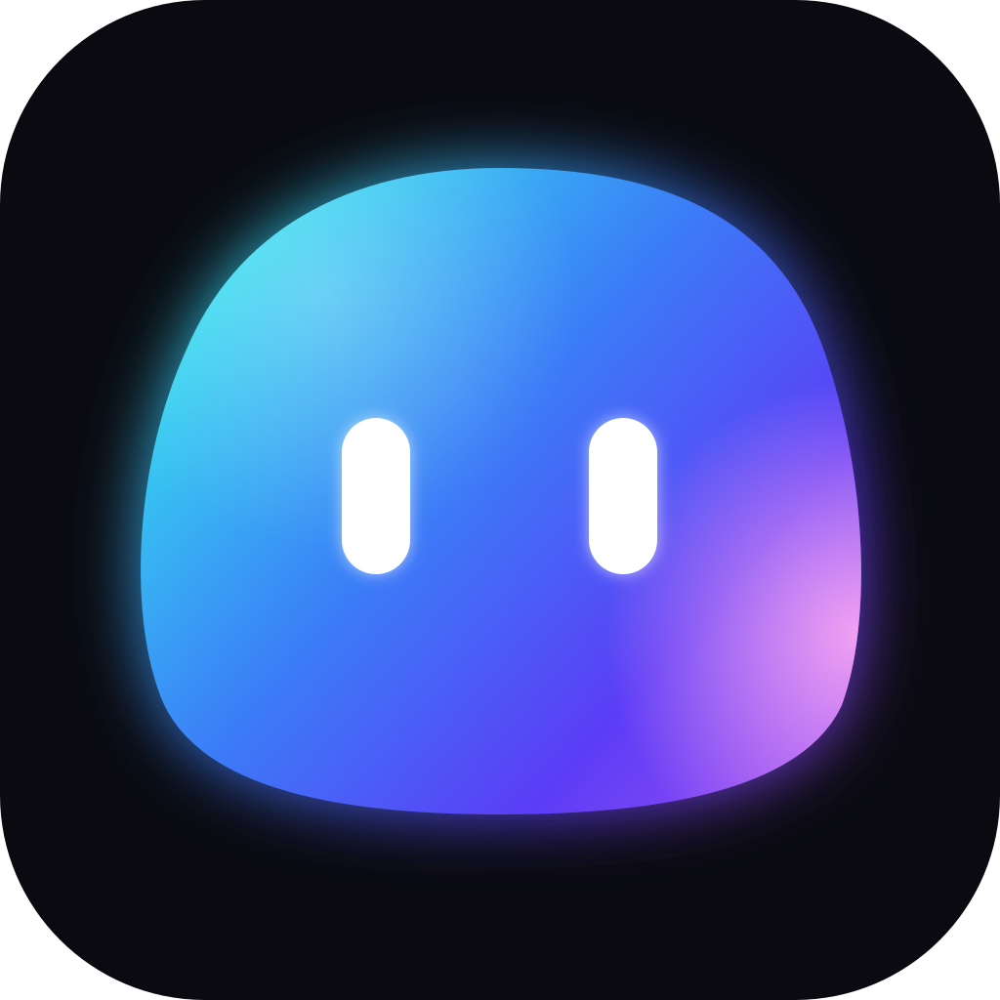
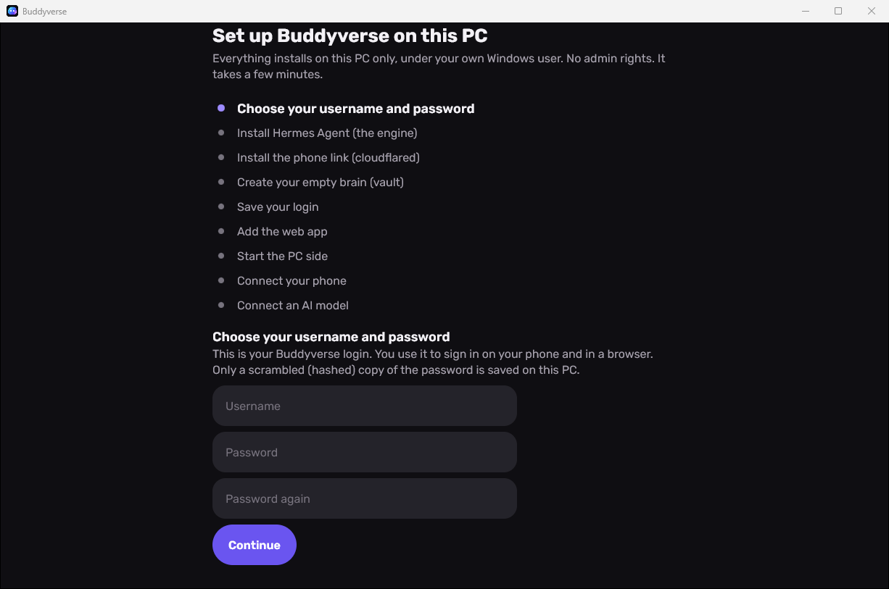

<p align="center"></p>

<h1 align="center">Buddyverse</h1>

<p align="center">Your own AI buddies, on your own PC. Free and open source (MIT).</p>

<p align="center"><b>Beta 0.1.0</b>: this is an early beta. Expect rough edges, and please report problems in
<a href="https://github.com/blueApple12/buddyverse/issues">Issues</a>.
The beta installs Hermes Agent's <b>canary</b> build (its daily preview), because Hermes' stable release doesn't have the
Webapp feature Buddyverse needs yet.</p>

Buddyverse is a Windows PC app, an Android app and a web app (for iPhone or any browser) for your own AI agents.
It runs [Hermes Agent](https://hermes-agent.nousresearch.com/docs) by Nous Research on your PC and shows each of your
bots as an animated buddy you can chat with. Your phone connects only to your own PC. There is no Buddyverse server
and no Buddyverse account.

**Download:** [Buddyverse-Setup.exe](https://github.com/blueApple12/buddyverse/releases/download/v0.1.0-beta/Buddyverse-Setup.exe) (Windows) ·
[Buddyverse.apk](https://github.com/blueApple12/buddyverse/releases/download/v0.1.0-beta/Buddyverse.apk) (Android) ·
[All releases](https://github.com/blueApple12/buddyverse/releases) ·
[Download page](https://blueapple12.github.io/buddyverse/)

## Contents

1. [What you need](#what-you-need)
2. [Install on your PC](#1-install-on-your-pc)
3. [First run](#2-first-run)
4. [Connect an AI model](#3-connect-an-ai-model)
5. [Connect your phone](#4-connect-your-phone)
6. [Every day](#5-every-day)
7. [Update](#update)
8. [Uninstall](#uninstall)
9. [FAQ and troubleshooting](#faq-and-troubleshooting)
10. [Let an AI agent set it up for you](#let-an-ai-agent-set-it-up-for-you)
11. [Privacy](#privacy)
12. [For developers](#for-developers)

## What you need

- A Windows 10 or 11 PC (64-bit). **No admin rights needed.**
- An internet connection during setup (it downloads Hermes Agent and cloudflared).
- An AI model: an API key or an account with a provider Hermes supports, for example OpenRouter, Anthropic (Claude),
  OpenAI, Google Gemini, Nous Portal, or any OpenAI-compatible server (also one running on your own PC).
- Optional: an Android phone (Android 9 or newer), or an iPhone with iOS 18.2 or newer.

## 1. Install on your PC

1. Download [Buddyverse-Setup.exe](https://github.com/blueApple12/buddyverse/releases/download/v0.1.0-beta/Buddyverse-Setup.exe).
2. Double-click it. If Windows shows **"Windows protected your PC"**, click **More info**, then **Run anyway**.
   (The installer is free and open source, but not code-signed, so Windows doesn't know it yet.)
3. It installs for your Windows user only, into `%LOCALAPPDATA%\Buddyverse`, and adds **Buddyverse** to the Start menu
   and the desktop. It does not ask for admin rights.
4. Open **Buddyverse** from the Start menu or the desktop shortcut.

## 2. First run

The first time it opens, Buddyverse sets up your PC. You see a list of steps with a dot on the current one and a check
mark on each finished one. If a step fails, it shows the reason and a **Retry** button. Every step skips what is already
done, so a retry (or opening the app again later) carries on where it stopped.



1. **Choose your username and password.** This is your Buddyverse login. You use it to sign in on your phone and in a
   browser. Username: letters, digits and `. _ @ -`. Password: at least 8 characters, no space at the start or end.
   Only a scrambled (scrypt-hashed) copy of the password is saved on the PC. Nobody can read it back, so remember it.
   (If this PC already has a Buddyverse login, it asks for that password instead.)
2. **Wait while it installs** (a few minutes, depending on your internet). Without admin rights it installs:
   - **Hermes Agent**, the AI engine, with its official installer. The beta installs the newest Hermes **canary**
     build (Hermes' daily preview, from 26 Oct 2026 on), because only canary builds have the Webapp that Buddyverse
     signs in to. If you already have Hermes, Setup reuses it, but it must be a canary build from 26 Oct 2026 or
     newer (see [FAQ](#faq-and-troubleshooting)). To keep the install quick it leaves out two optional Hermes extras
     Buddyverse doesn't need: the web browser bots can drive (Chromium, about 150 MB) and the desktop-control driver.
     Add them later with `hermes pm install chromium` and `hermes pm install cua-driver`;
   - **cloudflared**, the program that opens the private link your phone uses;
   - an **empty brain**: a notes vault for your bots in `%USERPROFILE%\buddyverse\brain`;
   - **your login** (saved as a hash in Hermes' settings);
   - the **web app**, so an iPhone or any browser can use Buddyverse.
3. **Start the PC side.** It starts Hermes and the phone link, and signs the PC app in.
4. **Connect your phone** (you can skip this with **Next**). See [Connect your phone](#4-connect-your-phone).
5. **Connect an AI model.** Press **Connect a model**, or **Later** to do it from Settings. See the next part.

## 3. Connect an AI model

Your bots need a model to think with. You can add, change or remove it at any time.

1. Open **More > Settings > Connect a model** (setup opens the same screen for you).
2. You see the list of providers Hermes supports, with a search box. Pick yours:
   - **API key** providers (for example OpenRouter, Anthropic, OpenAI, Google Gemini API): paste your key and press
     **Connect**. Buddyverse checks the key with the provider first when it can.
   - **Sign-in** providers: press **Sign in**. You get a short code and **Open the sign-in page**; sign in with
     your account there and enter the code. Some providers sign in with a command on the PC instead; the app shows which one.
   - **Your own server** (for example a model running on this PC or your network): **More > Models > Add an endpoint**, then enter its URL and model name.
3. Press **Pick one of its models** and choose the default model. That's it: your bots use it from the next message.

**Change or remove a key later:** **More > Models > Keys > All keys**. Tap a key to replace it, or **Remove the key**.
**Change the default model:** **More > Models**, tap the model at the top.

Keys are written only to Hermes' own settings file on your PC (`%LOCALAPPDATA%\hermes\.env`). They are never shown
in full again, never logged and never sent anywhere except to that provider.

## 4. Connect your phone

The phone talks only to your PC, through a private link your PC opens (a Cloudflare quick tunnel).

**Android**

1. On the PC, press the **Phone** button at the bottom of the side bar (or use the setup's phone step). Scan the
   **Android app** QR code with your phone's camera, or open
   [Buddyverse.apk](https://github.com/blueApple12/buddyverse/releases/download/v0.1.0-beta/Buddyverse.apk) on the phone.
2. Open the downloaded file. Android asks to allow **Install unknown apps** for your browser: allow it once, then install.
3. Open Buddyverse on the phone and choose to pair with a QR code.
4. Scan the **pairing code** on your PC screen.
5. Sign in with the username and password you chose.

After this first install, the Android app updates itself from your PC: when a new version is out, it shows a banner,
and you tap **Install** once.

**iPhone (or any browser)**

1. On the PC, press **Phone**. Under **Web version** you see a link.
2. Open that link in **Safari** on the iPhone (iOS 18.2 or newer) and sign in.
3. Tap **Share**, then **Add to Home Screen**. It now opens like an app and updates itself.

## 5. Every day

- Keep the PC on and Buddyverse open. When it opens, it starts Hermes and the phone link if they aren't running.
- Closing the window hides Buddyverse to the system tray (next to the clock). To stop it, right-click the tray icon
  and choose **Quit**.
- Nothing starts by itself when you sign in to Windows. After a restart, open Buddyverse again.
- The phone link changes when the PC restarts. Open **Phone** on the PC and scan again (iPhone: open the new link).

## Update

- **PC:** download the newest [Buddyverse-Setup.exe](https://github.com/blueApple12/buddyverse/releases/download/v0.1.0-beta/Buddyverse-Setup.exe)
  and run it. It updates the app in place. Your bots, chats, notes, login and keys stay: they live outside the app folder.
- **Android:** the app offers new versions by itself (they come through your PC). Or install the new APK over the old one.
- **iPhone / web:** it updates itself the next time you open it.
- **Hermes Agent** has its own updater: run `hermes update` in a terminal
  ([details](https://hermes-agent.nousresearch.com/docs)). The beta's canary build stays where it is until a Hermes
  stable release is newer than it; `hermes update` won't move it backwards.

## Uninstall

1. Quit Buddyverse (tray icon > **Quit**).
2. Windows **Settings > Apps > Installed apps > Buddyverse > Uninstall**. This removes the app only.
3. To also delete your Buddyverse data (vault, phone link, app settings), delete these folders:
   `%USERPROFILE%\buddyverse` and `%USERPROFILE%\.buddyverse`.
4. To also remove Hermes Agent (your bots, chats, keys and login), run `hermes uninstall` in a terminal, or delete
   `%LOCALAPPDATA%\hermes` after quitting. Its installer added `%LOCALAPPDATA%\hermes\bin` to your user PATH; you can
   remove that entry in **Settings > System > About > Advanced system settings > Environment Variables**.
5. Android: long-press the app > **Uninstall**. iPhone: long-press the icon > **Remove App**.

## FAQ and troubleshooting

**"Windows protected your PC" when I run the installer.**
The installer isn't code-signed. Click **More info**, then **Run anyway**. Only do this for a file you downloaded from
this repo's Releases page.

**A setup step failed.**
Read the short reason under the step (often: the internet dropped), fix it if you can, then press **Retry**. Setup
carries on from that step. With the headless setup, the full log is in `%USERPROFILE%\buddyverse\setup.log`.

**Setup says "this PC's Hermes Agent is too old for Buddyverse: it has no Webapp".**
You already had Hermes Agent, and it's a stable release (or an older build) without the Webapp. Setup never changes an
existing Hermes by itself. The message shows a PowerShell line that reruns Hermes' official installer pinned to the
newest canary build; your bots, chats, keys and settings stay. Run it in a normal terminal, then run
`hermes gateway restart` and press **Retry**. The same applies if the PC side "took too long to start" and mentions the
Webapp.

**Setup says "Hermes was already running, so it hasn't loaded your new login yet".**
You already had Hermes Agent running before you installed Buddyverse. Setup never stops it by itself (it may be busy
with your other bots). Run `hermes gateway restart` in a terminal, then press **Retry**.

**I forgot my password.**
It's stored only as a hash, so nobody can read it back. On the PC (still signed in): **More > Settings > Change
password**. If the PC app is signed out too: quit Buddyverse, open `%LOCALAPPDATA%\hermes\.env` in Notepad, delete the
lines that start with `HERMES_DASHBOARD_BASIC_AUTH_`, save, run `hermes gateway stop` in a terminal, and open
Buddyverse again: setup asks for a new username and password.

**My bots don't answer / "no model".**
No model is connected yet, or a key or sign-in expired. **More > Settings > Connect a model**.
Advanced: run `hermes model` (Hermes' own model picker) or `hermes doctor` in a terminal.

**My phone can't connect.**
1. Check the PC is on and Buddyverse is open.
2. The link changes when the PC or the link restarts. On the PC, open **Phone** and scan the new pairing code.
3. If **Phone** says the link isn't ready, wait a minute. Buddyverse starts the link by itself.
4. Some work, school or public Wi-Fi networks block Cloudflare quick tunnels (`*.trycloudflare.com`). Try another
   network or mobile data.

**Do I need to open ports or change my firewall?**
No. Hermes listens only on `127.0.0.1` (the PC itself). cloudflared makes an outgoing connection to Cloudflare. If a
firewall asks about Hermes, Python or cloudflared, allow it. Security software that blocks `cloudflared.exe` stops the
phone link.

**"Couldn't start the PC side" / port in use.**
Buddyverse uses port **9120** on `127.0.0.1`. If another program uses it, the gateway can't start. Close that program
and press **Retry**. To check, open `http://127.0.0.1:9120/api/status` in a browser on the PC.

**Can a friend use my Buddyverse?**
Each person installs their own: their own PC, their own Hermes, their own model account. Never give someone your
phone link and password: your bots can act on your PC.

**Does it cost money?**
Buddyverse is free. The AI model may cost money, depending on the provider and plan you pick (some have free models,
and you can run a model on your own PC).

**Is there a Mac or Linux version?**
Not yet. The PC app is Windows-only; the web app works in any modern browser once a Windows PC runs it.

## Let an AI agent set it up for you

Already use an AI coding agent (Claude Code, Codex CLI, Gemini CLI, Hermes)? Open it in a normal (non-admin) terminal
on your PC and paste the prompt from [docs/AI-SETUP-PROMPT.md](docs/AI-SETUP-PROMPT.md). It installs and configures
everything with the headless setup below, asks before it installs anything, and never asks you to type a password or
key into the chat.

## Privacy

- Everything runs on your PC: Hermes, your bots, your notes vault, your chats, your login and your keys.
- Your password is stored only as a scrypt hash. Your API keys stay in Hermes' own file on your PC.
- Your messages go only to the AI provider you chose. Your phone connects only to your PC, through a random Cloudflare
  link your PC opens, and every request needs your login.
- Nothing registers to run at Windows sign-in.
- No Buddyverse server, no account with us, no analytics, no tracking. The download page has no cookies or trackers.

## For developers

### Build from source

You need JDK 21, the Android SDK (platform 37; set `ANDROID_HOME` or put `sdk.dir=...` in `local.properties`),
Windows for the PC installer, and internet on the first build (Gradle downloads its tools, including Node for the web app).

```powershell
git clone https://github.com/blueApple12/buddyverse.git
cd buddyverse
./gradlew :shared:desktopTest            # tests
./gradlew :desktopApp:packageExe         # PC installer -> desktopApp/build/compose/binaries/main/exe/
./gradlew :androidApp:assembleRelease    # Android APK  -> androidApp/build/outputs/apk/release/
./gradlew :shared:webPlugin              # web app (a Hermes plugin) -> shared/build/hermes-plugin/
```

`packageExe` builds the web app too and puts it inside the PC installer, so first-run setup can install it.

**Signing the APK.** Without a key the release APK is signed with your local debug key (fine for testing, but Android
only updates an app signed with the same key). To use your own key, write a `keystore.properties` file **outside the
repo** with `storeFile` (relative to that file), `storePassword`, `keyAlias`, `keyPassword`, and point the build at it:
`$env:BUDDYVERSE_KEYSTORE = 'D:\keys\keystore.properties'` (or `-Pbuddyverse.keystore=...`). Never commit a keystore or
its passwords. CI can sign too: see `.github/workflows/build.yml`.

**Logo.** `branding/logo.svg` is the master. `python tools/set-logo.py` makes every icon from it (PC `.ico` and tray
icon, web app and download-page icons). `python tools/set-logo.py my-logo.png --android-png` uses a PNG instead. The
Android launcher icon is vector layers in `androidApp/src/main/res/drawable/ic_launcher_*.xml`.

### Headless setup (scripts, CI, AI agents)

```powershell
$p = Start-Process "$env:LOCALAPPDATA\Buddyverse\Buddyverse.exe" -PassThru -WindowStyle Hidden `
       -ArgumentList '--setup', '--username', 'alex', '--password-file', 'C:\path\to\pw.txt'   # add '--skip-phone' for no phone link
$null = $p.Handle; $p.WaitForExit(); $p.ExitCode
```

Runs the same first-run steps with no window, then exits. `Buddyverse.exe` is a windowed program, so start it with
`Start-Process` and wait as above (a plain `&` call doesn't wait). Progress goes to stdout (when redirected) and to
`%USERPROFILE%\buddyverse\setup.log`.

| Option | Env var | Meaning |
| --- | --- | --- |
| `--setup` | | Run setup with no window. |
| `--username <name>` | `BUDDYVERSE_USERNAME` | The new login's username. When the PC already has a login, it may be left out (if given, it must match). |
| `--password-file <path>` | `BUDDYVERSE_PASSWORD_FILE` | A UTF-8 text file. Only the first line is used; the line break after it (and a BOM) is ignored. `-` reads stdin. |
| | `BUDDYVERSE_PASSWORD` | The password itself, used only when no file is given (for CI secrets). |
| `--skip-phone` | `BUDDYVERSE_SKIP_PHONE=1` | No cloudflared and no phone link: only the local gateway. |

`--password` on the command line is refused on purpose (it would show in the process list). Delete the password file
when setup is done.

Exit codes: **0** done · **1** a setup step failed (the output says which; run it again, it resumes) · **2** bad options,
a missing username/password, or a login that breaks the rules (8+ characters, no leading/trailing space; username
letters, digits, `. _ @ -`) · **3** this PC already has a different login, or the password doesn't match it.

With no model connected, setup still exits 0 and prints `model: not connected yet`. Connect one in the app
(**More > Settings > Connect a model**) or with `hermes model`. The PC app asks for the login once on its first open
after a headless setup.

Setup leaves the gateway running (hidden) and never adds anything that starts at Windows sign-in.

For a second, isolated install beside an existing one (testing), set `BUDDYVERSE_HOME` (install root and app
settings), `BUDDYVERSE_HERMES_HOME` (Hermes' home) and `BUDDYVERSE_PORT` (gateway port, default 9120). Two Hermes
behaviors to know: its official installer adds its `bin` folder to your user PATH and also refreshes the launchers in
the default `%LOCALAPPDATA%\hermes\bin` (give the test its own `LOCALAPPDATA`), and Hermes runs **one gateway per PC**,
so a test install next to a running Hermes can't start its own gateway. A clean machine (or the CI `clean-install`
job) tests the whole flow.

### Contributing

Contributions are welcome. Open an issue first for big changes. Keep pull requests small, run
`./gradlew :shared:desktopTest` before you push, and say what you changed and how you tested it. Never commit secrets,
personal paths, tunnel links or login files.

## License

[MIT](LICENSE). Copyright (c) 2026 Buddyverse contributors.

Buddyverse is not affiliated with Nous Research. Hermes Agent is their project, under its own license.
